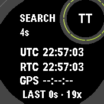
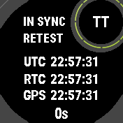
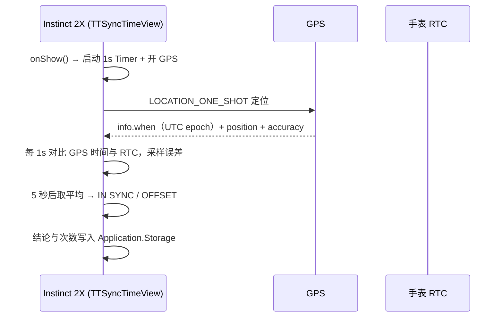

# TTSyncTime

> 在 Garmin Instinct 2X 上检查 GPS 时间与手表 RTC 的偏差。一个几百行的 Connect IQ Widget。


| 搜星中 | 已出结论 |
| --- | --- |
|  |  |

上方就是手表上的实际画面（176×176 原图）。

Instinct 2X 的系统时间由 GPS 自动校准，但表内 RTC 与 GPS 到底差多少平时看不到。
TTSyncTime 拿一次 GPS 定位，对比 GPS 时间与 RTC，观察几秒取平均后给出
「时间一致 / 存在偏差」的结论，并把历史误差存入 Storage，方便长期跟踪漂移。

> **许可**：PolyForm Noncommercial 1.0.0 —— **仅限非商业用途**，详见 [LICENSE](LICENSE)。

## 功能特性

| 特性 | 说明 |
| --- | --- |
| 一次定位出结论 | `LOCATION_ONE_SHOT` 拿一次 fix，不做持续定位，省电 |
| 平均误差抗抖动 | fix 后观察 5 秒取平均（`OBSERVE_SECONDS`），不拿单次读数下结论 |
| 判定阈值可调 | 平均误差 ≤ ±1s 判定「IN SYNC」（`SYNC_TOLERANCE`） |
| 三路时间对齐显示 | UTC / RTC / GPS 三行时钟按「标签右边界 + 时间左边界」双锚点列对齐 |
| 状态一目了然 | `SEARCH` / `CHECK` / `IN SYNC` / `OFFSET` / `GPS ERR` / `RTC ERR` / `TIMEOUT` |
| 历史跟踪 | 上次误差与累计测试次数存入 `Application.Storage`，搜星阶段显示 |
| 采光窗品牌字 | 右上角 Power Glass 采光窗内绘制 `TT`（半透明玻璃透出，为原版辨识点） |
| 八角屏适配 | 全部布局按屏幕比例 + 八角斜角/圆窗几何实测校准，无写死像素 |
| ENTER 重测 | 出结论后按 ENTER 重跑一轮；BACK 退出 |

## 工作原理



- **GPS 时间**：fix 的 `info.when` 起算，用系统时间差走秒，之后每秒与 RTC 对比一次
- **RTC**：`Time.getCurrentTime(:currentTimeType => Time.CURRENT_TIME_RTC)`，手表未拿到可信时间源时可能无效（显示 `RTC ERR`）
- **误差符号**：正 = RTC 落后 GPS

## 界面布局

Instinct 2X 是 176×176 八角屏，右上角有一个圆形采光窗（Power Glass）。
布局据此分为两段：

- 表头两行：状态行（TINY）+ 副信息行（XTINY，三态复用：搜星计时 / 定位精度 / 重测提示）
- 数据四行：UTC / RTC / GPS 三行时钟（行距 24px）+ 底部结果行（搜星计时、观察进度或大号误差）

状态行的可用宽度只到圆环左缘，文案过长会自动降一级字号。

## 目录结构

```
TTSyncTime/
├── LICENSE                      # PolyForm Noncommercial 1.0.0（禁止商用）
├── README.md
├── docs/RELEASE.md              # 版本与发布记录
├── manifest.xml                 # instinct2x / minApiLevel 3.4.0 / Positioning
├── monkey.jungle
├── resources/                   # 默认资源（英文）
│   ├── drawables/
│   ├── layouts/
│   └── strings/
├── resources-zhs/               # 简体中文文案（设备语言为中文时加载）
├── source/
│   ├── TTSyncTimeApp.mc         # 入口
│   ├── TTSyncTimeDelegate.mc    # ENTER 重测 / BACK 退出
│   └── TTSyncTimeView.mc        # 主视图（定位、误差统计、绘制）
└── screenshots/                 # 176×176 实拍截图
```

## 环境要求

- [Garmin Connect IQ SDK](https://developer.garmin.com/connect-iq/sdk/)（开发时使用 9.2.0）
- 支持机型：Instinct 2X / 2X Solar（`instinct2x`）

## 构建

```bash
monkeyc -f monkey.jungle -o bin/TTSyncTime.prg -d instinct2x -w -y <你的开发者密钥>
```

模拟器运行：

```bash
simulator -d instinct2x &
monkeydo bin/TTSyncTime.prg instinct2x
```

## 安装到手表

侧载：把 `bin/TTSyncTime.prg` 拷贝到手表的 `GARMIN/APPS/` 目录，重启手表后在小工具环出现 **TTSyncTime**。
（开发者模式下通过 USB 访问手表存储。）

## 使用说明

1. 进入 Widget 后自动开始搜星，表头副行显示已用时（`13s`），90 秒未定位则 `TIMEOUT`
2. 拿到 fix 后进入 5 秒观察期，显示 `3/5` 进度与定位精度
3. 结束后显示结论：`IN SYNC`（一致）或 `OFFSET`（有偏差），底部大号显示平均误差（如 `+2s`）
4. 按 **ENTER** 重测，按 **BACK** 退出

## 已知限制

- 需要 GPS 信号：室内或电梯里会一直 `SEARCH` 直到超时
- Widget 显示几秒就会被系统回收，长时间观察请在模拟器或反复进入
- 仅适配 `instinct2x`（其他 MIP 圆窗机型需重调布局常量）

## 参与贡献

Issue / PR 欢迎交流，但请保持非商用许可不变。

## 免责声明

本项目与 Garmin Ltd. 无关。Garmin、Instinct 是 Garmin Ltd. 的商标。
时间同步结果仅供参考，不构成对讲时、授时等场景的精度承诺。

## 许可

[PolyForm Noncommercial License 1.0.0](LICENSE) —— **仅限非商业用途**，
商业使用须另行取得书面授权。
